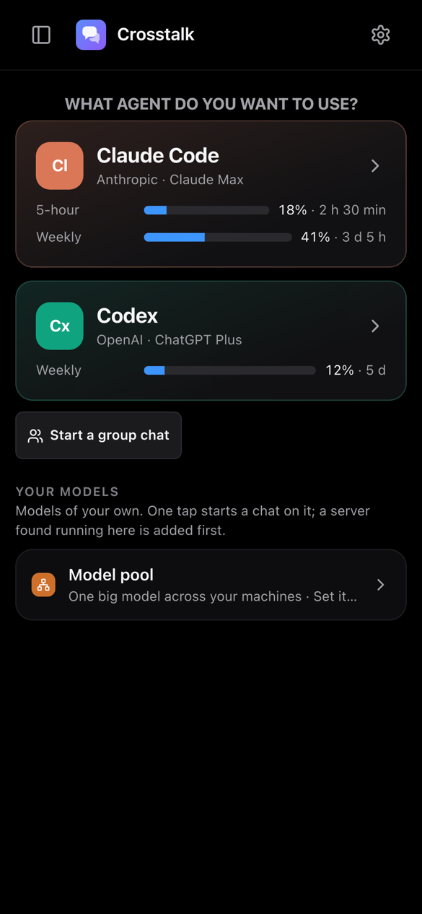
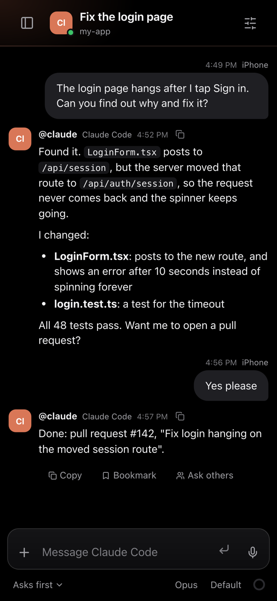
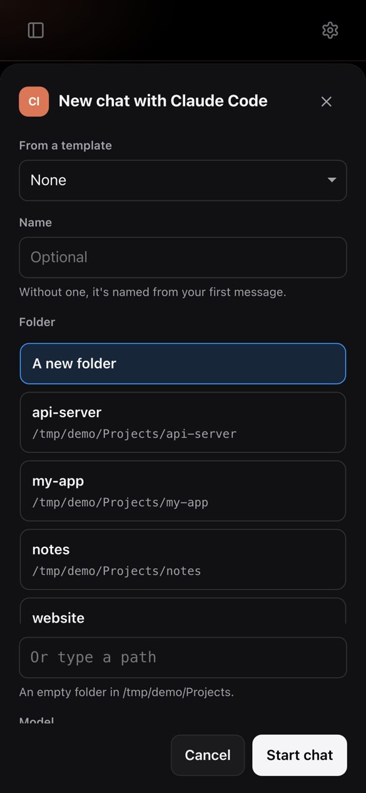

# Crosstalk

**Chat with Claude Code and Codex from your phone, while they work on your own computer.**

Crosstalk runs the official Claude Code and Codex tools on a computer you leave on (a Mac, a Linux box or a Windows PC),
signed in to *your* plan. Then you chat with them from any phone, tablet or browser: start a chat in a project folder,
watch them work, answer their questions, approve what they run, and pick up where you left off on another device.

<p align="center">
  
  
  
</p>

- **Your plan, your computer.** Agents use your own Claude or ChatGPT subscription (or an API key), on your own
  hardware. Crosstalk never sees your passwords; each agent signs in through its own official sign-in.
- **Private by default.** Your phone reaches your computer over [Tailscale](https://tailscale.com), your own private
  network. Nothing is exposed to the internet and there's no Crosstalk server or account.
- **Made for phones.** An installable web app (Add to Home Screen) with notifications, plus native apps.

## What you need

| | |
|---|---|
| **A computer that stays on** | A Mac (best if you build iPhone apps), a Linux machine, or a Windows 10/11 PC. Your agents work here. |
| **An agent plan** | Claude Pro or Max for Claude Code, and/or ChatGPT Plus or Pro for Codex. An API key from an AI service works too. |
| **Tailscale** (free) | On that computer and on your phone, signed in to the same account. |

## Get started

**1. Install Tailscale** on the computer and on your phone ([download](https://tailscale.com/download)) and sign in to
both with the same account. In the [Tailscale admin console](https://login.tailscale.com/admin/dns), under DNS, turn on
**HTTPS Certificates**.

**2. Install Crosstalk on the computer.** Open a terminal and paste one line:

```bash
# Mac or Linux
curl -fsSL https://raw.githubusercontent.com/channelramble/crosstalk-app/main/install.sh | bash
```

```powershell
# Windows (PowerShell)
irm https://raw.githubusercontent.com/channelramble/crosstalk-app/main/install.ps1 | iex
```

It installs the hub as a background service that starts by itself, and ends by printing an **address** and a
**pairing code**.

**3. Open that address on your phone** and enter the code. Then:

- Tap **Share → Add to Home Screen** (iPhone) or **Install app** (Android) to get an app icon and notifications.
- On the welcome card, tap **Sign in to Claude Code** or **Sign in to Codex**. You sign in on the agent's own page
  from your phone; no need to be at the computer.
- Tap **Start a chat**, pick a folder, and say hello.

Stuck? The step-by-step guide with pictures is in **[docs/GETTING-STARTED.md](docs/GETTING-STARTED.md)**, including
what to do when something doesn't work.

## What you can do

**Chats**
- One chat per task, each in a project folder. Pick a folder from the list of folders on the computer, or type a path.
- **Group chats**: two to six agents in one conversation (say, Claude Code builds and Codex reviews).
- **Answer, approve, stop**: questions and permission requests show up as cards; Stop works any time.
- **Rewind** to any point, **edit** or **unsend** a message: the agent forgets what came after. (Files it already
  changed stay changed.)
- **Ask others**: from any message, ask another agent or model for a second opinion, side by side.
- **Helpers**: agents can start background helpers; you keep chatting while they work.
- **Attach** files, photos and whole folders; **dictate** messages.
- **Search** every chat, **pin** the ones you use most, **bookmark** messages to find them later, export a chat as
  Markdown, or duplicate it.
- **Templates**: save prompts you use often, with blanks to fill in.
- Continue sessions you started in the Claude or Codex apps on the computer.

**Your plans and costs**
- See how much of each plan's 5-hour and weekly limits you've used, on every agent.
- Costs per chat and per account, with spending limits that warn at 80% and stop at 100%.
- A reply stopped by a plan limit waits and carries on when the limit resets.

**More models**
- **AI services**: add Kimi, DeepSeek, Mistral, OpenRouter, Groq, xAI, Gemini, Venice and others with an API key, and
  run them inside Claude Code or Codex.
- **Local models**: find, download and run open models on your own computer (Ollama, LM Studio, llama.cpp). Crosstalk
  tells you whether a model fits your machine first.
- **Model pool**: split one big model across several of your computers.

**Several computers**
- Link more computers (say, a Mac and a Linux box) and see all their chats in one app.
- Let agents run commands on another computer you connect, like a laptop with a phone plugged in.

**Set and forget**
- Notifications when an agent finishes or needs you.
- If an agent's sign-in stops working, every device tells you, with a Sign in button.
- On a Mac: warnings about what would stop it running unattended (sleep, automatic login, privacy dialogs waiting on
  its screen), most fixable from your phone.

## Updating

Run the same install line again. Open pages show **"Crosstalk was updated. Reload"** once the new version runs.

To remove it, see [Uninstall](docs/GETTING-STARTED.md#uninstall). Your chats stay in `~/.crosstalk` until you delete
that folder.

## Questions

**Does it cost anything?** Crosstalk is free. Agents use your own plan or API key, so they cost what they cost you
anyway.

**Who can reach my computer?** Only devices on your Tailscale network that you've paired with a code. Pairing codes are
single-use and expire. You can remove a device in Settings → Devices.

**Can agents break things?** Each agent has a permission level per chat, from "Read-only" to "Full access". Anything
above what it's allowed shows up on your phone to approve first. They're real coding agents with real access to the
computer, so start each chat in a project folder, not your home folder.

**Do I need to keep my phone open?** No. The agents run on the computer; the app just shows what they're doing.

**Can I use it on my laptop too?** Yes: open the same address in any browser on your tailnet, or install a native app.

## For developers

How it's built, how to run it from source, the native apps and the tests: **[docs/DEVELOPMENT.md](docs/DEVELOPMENT.md)**.
Other guides: [group chats](docs/GROUP-CHATS.md), [local models](docs/LOCAL-MODELS.md),
[model pool](docs/MODEL-POOL.md), [setting up with an AI agent](docs/SETUP-FOR-AGENTS.md),
[the hub menu-bar app](docs/HUB-APP.md), [image editor](docs/IMAGE-EDITOR.md).
