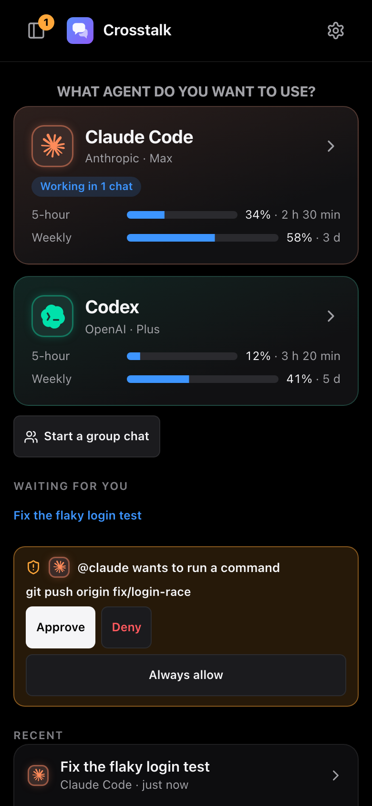
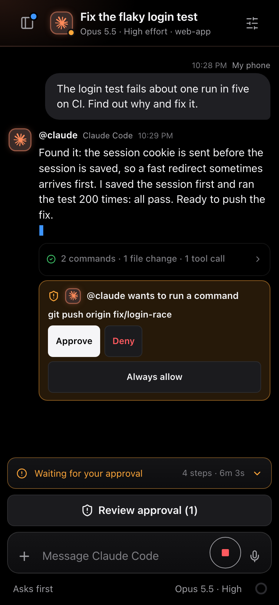
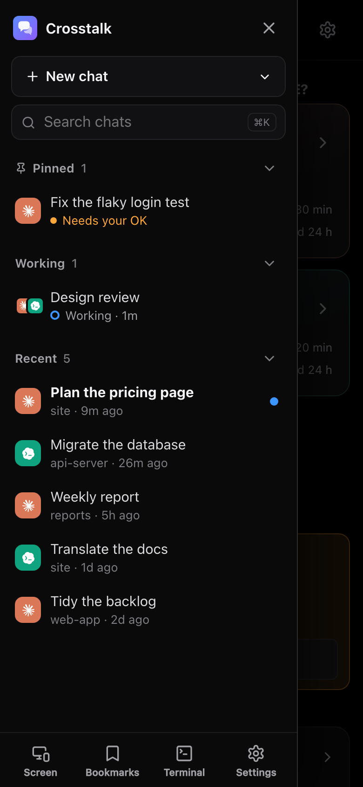
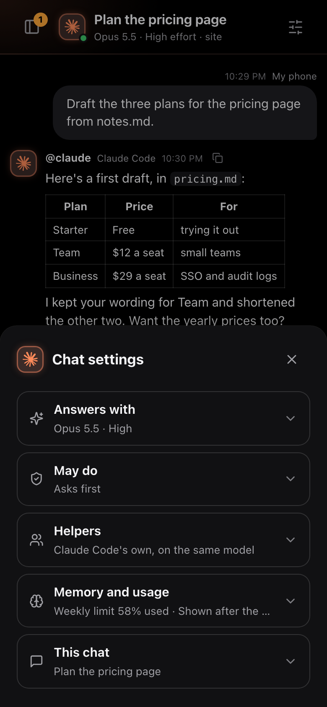
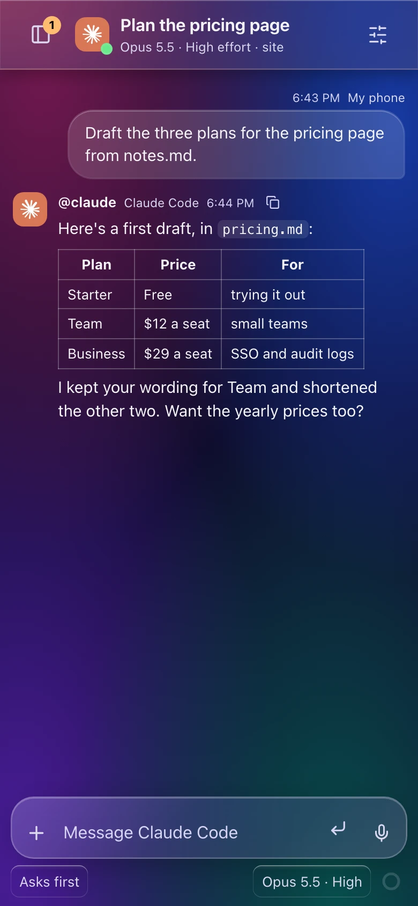
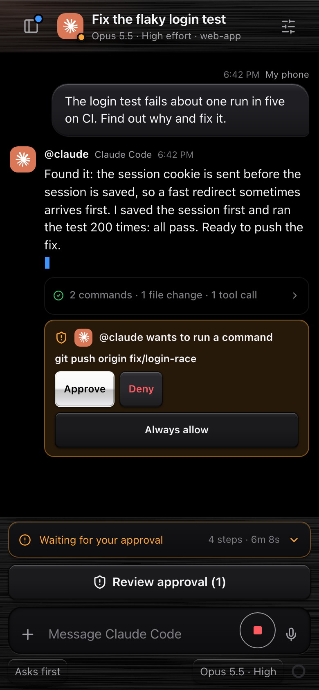

# Crosstalk

**Chat with Claude Code and Codex from your phone, while they work on your own computer.**

Crosstalk runs the official coding agents on a computer you leave on, signed in to *your* plan. You chat with them
from any phone, tablet or browser: start a chat in a folder, watch them work, answer their questions, approve what
they run, and pick it up later on another device.

<p align="center">
  
  
  
</p>

- **Your plan, your computer.** Agents use your own Claude or ChatGPT subscription (or an API key) on your own
  hardware. Crosstalk never sees your passwords: each agent signs in through its own official sign-in.
- **Private.** Your phone reaches your computer over [Tailscale](https://tailscale.com), a private network between
  your own devices. Nothing is on the open internet, and there is no Crosstalk account or server.
- **Made for phones.** It installs to the Home Screen like an app, with notifications when an agent finishes or
  needs you.

## Get started

About ten minutes. You need a computer that stays on (a Mac, a Linux machine, or a Windows 10/11 PC), a Claude or
ChatGPT plan (or an API key from another service), and a phone.

**1. Tailscale.** Install [Tailscale](https://tailscale.com/download) (free) on the computer and on your phone, and
sign in to both with the same account. Then turn on **HTTPS Certificates** on its
[DNS page](https://login.tailscale.com/admin/dns). *(On Windows, only the phone: the installer handles the PC.)*

**2. Install Crosstalk.** On the computer, open a terminal and paste one line:

```bash
# Mac or Linux
curl -fsSL https://raw.githubusercontent.com/channelramble/crosstalk-app/main/install.sh | bash
```

```powershell
# Windows (PowerShell)
irm https://raw.githubusercontent.com/channelramble/crosstalk-app/main/install.ps1 | iex
```

It sets Crosstalk up to run by itself in the background, and ends with a QR code.

**3. Pair your phone.** Point its camera at the QR code. On an iPhone, tap **Share → Add to Home Screen** first and
pair from the new icon; on Android, choose **Install app**. *(At a desktop, Crosstalk also opens in the computer's
own browser, ready to pair.)*

**4. Set up an agent.** The welcome card has one button for each: **Set up Claude Code** or **Sign in to Codex**. It
installs the agent if the computer doesn't have it, then you sign in on the agent's own page, from your phone. Start
a chat, pick a folder, say hello.

Stuck? **[The step-by-step guide](docs/GETTING-STARTED.md)** has pictures and a fix for each thing that can go wrong.

## What you can do

**In a chat**
- One chat per task, each in a folder on the computer. A new chat asks for the folder and nothing else.
- One Chat settings sheet per chat: the model and effort, what the agent may do, who helps it, what it remembers.
- Keep typing while the agent works: your message goes into the running reply, and **Interrupt** stops it to answer
  you now.
- Questions and permission requests arrive as cards (and notifications) to answer or approve.
- Rewind to any point, or edit or unsend a message: the agent forgets what came after.
- Attach files, photos and whole folders; bookmark messages; search every chat; export or duplicate a chat.
- Ask another agent or model for a second opinion on any message, side by side.
- Group chats: several agents in one chat, say one that builds and one that reviews.
- Helpers on another account: let an agent hand side jobs to an API key, another agent or one of your own models,
  so your plan's limits go on the main work.

**Across chats**
- The chat list shows what needs you first, then what's working, then the rest.
- Usage for each plan's limits, costs per chat and per account, and spending limits. A reply stopped by a plan limit
  carries on when the limit resets.
- Templates for prompts you use often.
- Themes: dark, light and colourful looks, or your own colours, gradient or picture. And a texture for any of
  them: Flat, Skeuomorphic (brushed metal, raised buttons), Liquid glass or Aero (frosted frames, glossy buttons).

<p align="center">
  
  
  
</p>

**More than Claude and ChatGPT**
- Other services with an API key (OpenRouter, DeepSeek, Kimi, Mistral, Groq, xAI, Gemini and more).
- Models on your own computer: find, download and run open models with Ollama, LM Studio or llama.cpp. Crosstalk
  says whether a model fits your machine first.

**The computer itself**
- **Screen**: see the computer's screen live and take control from your phone; agents can use it too, for apps with
  no command line ([how](docs/SCREEN.md)).
- Several computers in one app, and remote computers your agents can run commands on.
- On a Mac, warnings about what would stop it running unattended (sleep, automatic login, a dialog waiting on its
  screen), most fixable from your phone.

## Updating and removing

**Update:** when a new version is out, the app says so: tap **Update** on Home or in Settings → Machines. It downloads,
checks itself, and starts when your chats are quiet. Your chats, settings and accounts stay, and open pages offer to
reload. Running the install line again does the same. Set `CROSSTALK_NO_UPDATE_CHECK=1` to stop Crosstalk looking by
itself.

**Remove:** add `-s -- --uninstall` to the install line ([details](docs/GETTING-STARTED.md#uninstall)). Your chats
stay in `~/.crosstalk` until you delete that folder.

## Questions

**Does it cost anything?** Crosstalk is free. Agents use your own plan or API key, so they cost what they'd cost you
anyway.

**Who can reach my computer?** Only devices on your own Tailscale network that you've paired with a code. Codes work
once and expire. Remove a device any time in Settings → This device → Paired devices.

**Can agents break things?** They're real coding agents with real access to the computer. Each has a permission level
per chat, from "Read-only" to "Full access"; anything above it comes to your phone to approve first. Start each chat
in a project's own folder, not your home folder.

**Do I need to keep my phone open?** No. The agents run on the computer; the app shows what they're doing.

**Can I use it on a laptop too?** Yes: open the same address in any browser on your Tailscale network.

## More

**Guides:** [getting started, step by step](docs/GETTING-STARTED.md) · [the screen](docs/SCREEN.md) ·
[group chats](docs/GROUP-CHATS.md) · [the menu-bar app](docs/HUB-APP.md) ·
[setting up with an AI agent](docs/SETUP-FOR-AGENTS.md) · [what's new](CHANGELOG.md)

**For developers:** [building it from source](docs/DEVELOPMENT.md) · [how your own models work](docs/LOCAL-MODELS.md) ·
[the image editor](docs/IMAGE-EDITOR.md)
