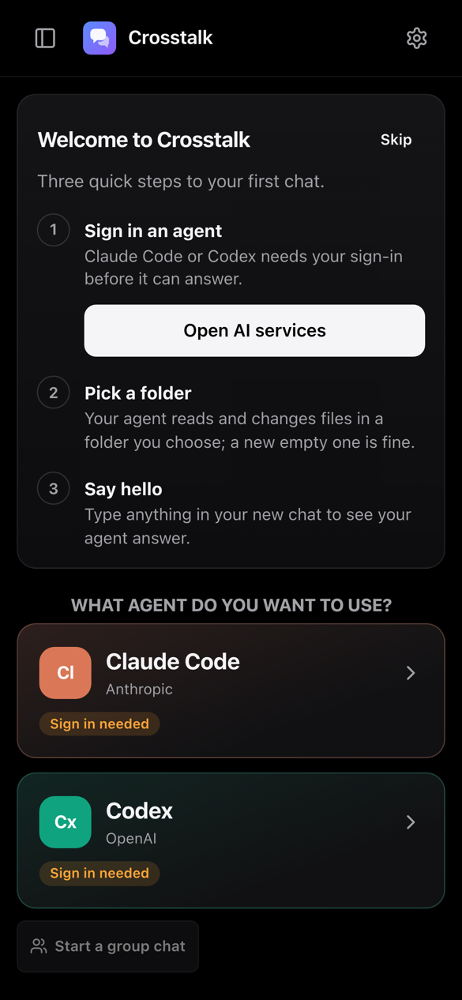

# Getting started with Crosstalk

About 15 minutes, start to first chat. You'll set up two things:

- **The hub**: the computer your agents work on. It stays on, like a little server. Mac, Linux or Windows.
- **Your phone** (and any other device): where you chat. Nothing to install but a browser.

They talk over [Tailscale](https://tailscale.com), a free private network between your own devices, so the hub is never
on the open internet.

---

## 1. Tailscale

1. Install Tailscale on the hub computer and on your phone: <https://tailscale.com/download>.
2. Sign in to **both** with the same account (Google, Microsoft, GitHub or Apple all work).
3. Open the [admin console's DNS page](https://login.tailscale.com/admin/dns) and turn on **HTTPS Certificates**.
   (MagicDNS, on the same page, should already be on.)

> **Windows:** skip installing Tailscale on the PC itself. The installer puts it inside WSL for you (step 2).

## 2. Install the hub

On the hub computer, open a terminal (**Terminal** on a Mac, **PowerShell** on Windows) and paste the line for your
system.

### Mac

```bash
curl -fsSL https://raw.githubusercontent.com/channelramble/crosstalk-app/main/install.sh | bash
```

What it does, in order: installs the hub to `~/.local/bin`, runs it in the background (it starts by itself when you
log in), asks for your password once to keep the Mac awake and restart it after a power cut, checks the tools agents
use (Xcode, Homebrew, Node) and tells you what's missing, then publishes the hub on your tailnet.

Worth doing on a Mac that runs on its own:
- **Automatic login** (System Settings → Users & Groups): after a restart, the hub only starts once someone logs in.
  It isn't available while FileVault is on.
- **Xcode** from the App Store, opened once, if your agents will build iPhone or Mac apps.

### Linux

```bash
curl -fsSL https://raw.githubusercontent.com/channelramble/crosstalk-app/main/install.sh | bash
```

Needs systemd (Ubuntu, Debian, Fedora and most others). It installs the hub to `~/.local/bin`, adds a user service
that keeps running after you log out (asks for your password once), and publishes it on your tailnet. Install `git`,
`curl` and `nodejs`/`npm` if it says they're missing.

### Windows

```powershell
irm https://raw.githubusercontent.com/channelramble/crosstalk-app/main/install.ps1 | iex
```

The hub runs on Linux, so on Windows it runs inside **WSL2**, Microsoft's built-in Linux. The installer:

1. Installs WSL2 and Ubuntu if needed. It opens an administrator window for that. Windows may ask you to **restart**:
   do, then paste the same line again.
2. On Ubuntu's first start, asks you to pick a Linux **username and password**. Remember the password: the next steps
   ask for it.
3. Installs Tailscale inside Ubuntu and shows a link: open it to add Ubuntu to your tailnet.
4. Installs the hub inside Ubuntu.
5. Keeps Ubuntu running whenever you're logged in to Windows, and offers to stop the PC sleeping while plugged in.

Your projects live in Ubuntu's own files (`\\wsl$\Ubuntu-24.04\home\<you>` in File Explorer). The hub runs while you're
logged in to Windows; for a PC that runs unattended, turn on automatic sign-in.

### When it's done

The last lines look like this:

```
  ┌──────────────────────────────────────────────┐
  │ Pair your first device                       │
  │ Open https://your-computer.tail1234.ts.net   │
  │ and enter the code:  ABCD-EFGH               │
  └──────────────────────────────────────────────┘
```

Keep that window open for the next step. (Lost it? Run `~/.local/bin/crosstalk-hub pair` on the hub for a new code;
on Windows, `wsl -- ~/.local/bin/crosstalk-hub pair`.)

## 3. Pair your phone

1. On your phone, make sure Tailscale is **on**.
2. Open the address from the hub in Safari or Chrome.
3. Enter the pairing code and tap **Pair this device**.
4. Make it an app: **Share → Add to Home Screen** on iPhone, **⋮ → Install app** on Android. Open it from the new
   icon from now on: that's also what lets it send notifications.

To add more devices later: **Settings → Devices → Pair a new device** shows a code and a QR code.

## 4. Sign in an agent

The app opens on a **Welcome** card with three steps.



1. Tap **Sign in to Claude Code** (or **Sign in to Codex**).
   - **Claude Code**: tap **Open the sign-in page**, sign in with the Claude account that has your Pro or Max plan,
     then copy the code it shows and paste it back into Crosstalk.
   - **Codex**: tap **Open the sign-in page** and enter the short code it shows, signed in with your ChatGPT account.

   You do this from your phone; you never need to be at the hub. Crosstalk never sees your password.
2. Tap **Start a chat** and pick a folder: one of the folders listed, or **A new folder**, or type a path.
3. Say hello.

Don't have a Claude or ChatGPT plan? **Use another AI service** adds one with an API key (OpenRouter, DeepSeek, Kimi,
Gemini and more).

## 5. Make it yours (optional)

- **Notifications**: Settings → Devices → turn notifications on for this device.
- **Agent defaults**: Settings → Agents → each agent's model, effort and permission level for new chats.
- **Templates**: Settings → Agents → Templates, for prompts you use often.
- **Another computer**: Settings → Machines → Link a machine.
- **Let an AI agent finish the setup**: Settings → Agents → *Set up with an AI agent* gives one command that lets
  Claude Code or Codex on the hub check everything and fix what it can, asking you first.

---

## Troubleshooting

**The address doesn't open on my phone.**
Tailscale must be on, on both. Check the hub computer shows as connected in the Tailscale app. If the installer said
`tailscale serve failed`, run what it suggests (`sudo tailscale set --operator=$USER`) and run the install line again.
HTTPS certificates must be on in the admin console (step 1.3).

**"That code didn't work."**
Codes are used once and expire. Make a new one on the hub with `~/.local/bin/crosstalk-hub pair`.

**The agent says it isn't installed.**
Settings → Agents → the agent → **Install**. It runs the official installer in a terminal you can watch. Codex needs
`npm`.

**Sign-in finished but the agent still says it isn't signed in.**
Tap **Check** next to the account in Settings → Agents, or try **Sign in** once more.

**It worked, then stopped after a restart.**
The hub starts when you log in to the computer. Turn on automatic login (Mac), automatic sign-in (Windows), or check
the service on Linux: `systemctl --user status crosstalk-hub`.

**Where are the logs?**
Mac: `~/Library/Logs/Crosstalk/hub.log`. Linux and Windows (inside Ubuntu): `journalctl --user -u crosstalk-hub`.

## Updating

Run the install line again. Your chats, settings and sign-ins stay.

## Uninstall

This removes the background service. Your chats stay in `~/.crosstalk` (delete it to remove them too), and the hub
program in `~/.local/bin/crosstalk-hub`.

```bash
# Mac or Linux
curl -fsSL https://raw.githubusercontent.com/channelramble/crosstalk-app/main/install.sh | bash -s -- --uninstall
```

On Windows, run the same line inside Ubuntu (`wsl`), then remove the task that keeps it running:
`Unregister-ScheduledTask -TaskName "Crosstalk hub (WSL)"` in PowerShell.
