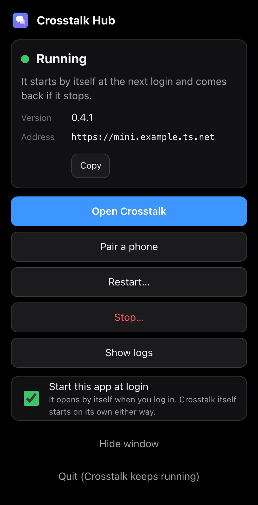
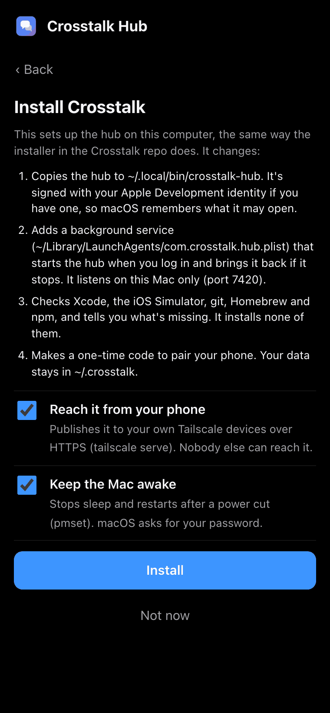

# Crosstalk Hub: the menu bar and tray app

Crosstalk Hub is a small app for the computer the hub runs on. It sits in the menu bar (macOS) or the tray (Linux) and
shows whether the hub is running, its version and its address. From its menu or its window you can open Crosstalk,
pair a phone, start, stop and restart the hub, and read its log, without a terminal. With no hub on the computer yet,
it offers to install one.

The source is `native/hub-tray/`: `core/` is plain Rust (the service, health, pairing, logs), `src-tauri/` the Tauri 2
app around it, `ui/` its window (HTML, CSS and JS, no build step). The app is **Crosstalk Hub**, bundle id
`com.channelramble.crosstalk.hub-app`, executable `crosstalk-hub-app` (on Linux the package is `crosstalk-hub-app` too).
It never uses the hub's own names (`com.crosstalk.hub`, `crosstalk-hub`): macOS tells programs apart by them.



## It never starts the hub itself

The hub stays what the installers made it: a LaunchAgent on macOS (`~/Library/LaunchAgents/com.crosstalk.hub.plist`),
a systemd user service on Linux (`~/.config/systemd/user/crosstalk-hub.service`). The app only asks launchd or systemd
to start, stop or restart it, and the hub is never the app's child.

That matters on macOS. Privacy permissions (folders, drives, Full Disk Access) belong to the program that starts a
process. A hub started by the app would lose the permissions the hub has been given, and macOS would ask again on the
Mac's screen. For the same reason, what the app runs itself touches nothing protected: `crosstalk-hub pair` now opens
only the hub's data folder (no config file, no workspace folder), and `crosstalk-hub version` reads nothing.

Quitting the app quits only the app. The hub keeps running.

## The menu

| Item | What it does |
| - | - |
| *Crosstalk: Running* (first line) | How the hub is. Linux trays have no tooltip, so it's said here. |
| *Version 0.4.1 · mini.tailnet.ts.net* | The running version and the address phones use. |
| Open Crosstalk | Opens the web app in the browser. |
| Pair a phone… | Opens the window with a one-time code and its QR code. |
| Start | Starts a stopped hub. |
| Stop… | Opens the window, which asks twice. |
| Restart when it's quiet | Restarts after five idle minutes. While it waits, this says *Cancel the waiting restart*. |
| Restart now… | Opens the window, which asks twice. |
| Show logs | Opens the window on the end of the hub's log. |
| Show window | The same things in a window. Closing the window hides it to the menu bar or tray; an error shown there, or a Stop or Restart now not yet confirmed, goes with it. |
| Start at login | Whether this app opens when you log in. |
| Quit (Crosstalk keeps running) | Quits the app; the hub keeps running. |

With no hub installed the menu is shorter: *Install Crosstalk…* (or *Set up the background service…* when the hub
binary is there without a service), *Show window*, *Start at login* and *Quit*.

The icon is the logo's two speech bubbles: filled when the hub runs, dimmed while it starts, outlined when it's stopped
or not installed, outlined with a dot when it needs a look. macOS draws it as a template icon (black or white with the
menu bar); Linux gets colour icons.

## What each action runs

`<uid>` is your user id (`id -u`). The label and unit are the installers' defaults.

| Action | macOS | Linux |
| - | - | - |
| Status | `launchctl print gui/<uid>/com.crosstalk.hub`, then `GET http://127.0.0.1:<port>/api/health` | `systemctl --user show crosstalk-hub --property=LoadState,ActiveState,SubState,MainPID,ExecMainStatus,ExecMainCode,UnitFileState,FragmentPath --no-pager`, then the same health check |
| Start | `launchctl enable gui/<uid>/com.crosstalk.hub` and `launchctl bootstrap gui/<uid> ~/Library/LaunchAgents/com.crosstalk.hub.plist`; `launchctl kickstart gui/<uid>/com.crosstalk.hub` when it's loaded but not running | `systemctl --user start crosstalk-hub` (after `systemctl --user daemon-reload` when systemd doesn't know the unit yet) |
| Stop | `launchctl bootout gui/<uid>/com.crosstalk.hub` | `systemctl --user stop crosstalk-hub` |
| Restart when it's quiet | `~/.crosstalk/bin/restart-when-idle.sh` (see below), else the app's copy of `deploy/restart-when-idle.sh`, detached, in the hub's data folder, logging to `~/Library/Logs/Crosstalk/restart-when-idle.log`; after five idle minutes it runs `launchctl kickstart -k gui/<uid>/com.crosstalk.hub` | the same script, logging to `~/.local/state/crosstalk/restart-when-idle.log`; it runs `systemctl --user restart crosstalk-hub` if the unit is still active |
| Cancel the waiting restart | SIGTERM to the waiting script (and its `sleep`) | the same |
| Restart now | `launchctl kickstart -k gui/<uid>/com.crosstalk.hub` | `systemctl --user restart crosstalk-hub` |
| Pair a phone | `~/.local/bin/crosstalk-hub pair 30` | the same |
| Show logs | the last 300 lines of `~/Library/Logs/Crosstalk/hub.log` (the plist's `StandardOutPath`); *Open in Console* runs `open -a Console` on it | `journalctl --user -u crosstalk-hub -n 300 --no-pager -o short-iso` |
| Open Crosstalk | `open <address>` | `xdg-open <address>` |

Notes:

- **Stop** lasts until you tap Start, or until the next login (macOS) or start of the computer (Linux): the plist or unit
  stays where it is. Replies that are running stop; a hub that hasn't exited five seconds after SIGTERM gets SIGKILL from launchd. Stop
  unloads the job rather than killing the process, because `KeepAlive` would bring a killed hub straight back. A
  waiting restart is cancelled first (the last step says so): on Linux its `systemctl --user restart` would start the
  stopped hub again.
- **Errors** say what happened and offer a way out: Try again, Show logs or Open Login Items. One from the menu opens the
  window, whose Try again runs that action again the window's way. Try again on a failed Stop or Restart now goes back
  to its last step: it never stops or restarts in one tap.
- **Restart** waits until no reply or ask has run and no Claude helper has written for
  five minutes, and gives up after six hours. Only one waits at a time; one started by hand counts too (the app finds
  `restart-when-idle.sh` and the older `restart-when-turns-end.sh` with `ps`). Only your account's count, and not one
  waiting for another hub: the app starts each in its hub's data folder, so one working in another hub's data folder (a
  trial's) is that hub's. A shell's `-c` command that merely names the script isn't one. It keeps waiting if you quit
  the app.
  The script is the maintained copy, `~/.crosstalk/bin/restart-when-idle.sh`, when it's there: the deploy steps
  keep it up to date with the hub, while the app's own copy is as old as the app and may not know newer kinds of work
  (0.4's asks, for one). A copy from before 0.4.1 is used only on macOS with the data in `~/.crosstalk`, the one setup it
  knows; elsewhere, and in trials, the app's copy runs.
  On Linux it needs the `sqlite3` command (`sudo apt install sqlite3`); without it the app says so and offers
  Restart now. On Linux the script leaves a hub that was stopped meanwhile alone (`systemctl --user is-active` first).
  **Restart now** asks twice and restarts at once, cutting off replies that are running. It cancels a waiting restart
  first, which would otherwise restart the hub a second time.
- **Pair a phone** runs the hub's own CLI with only `HOME`, `PATH`, `LANG` and the service's `CROSSTALK_HOME`, so the
  code goes into the database the running hub uses. The code works once, for 30 minutes. The QR code opens
  `<public address>/#pair=<code>`, the same link the web app's Pair a device makes. When the hub isn't published with
  Tailscale there is no address a phone can reach, so the window shows the code and says so.
- **Status** checks every 5 seconds, and every second for 30 seconds after an action. `crosstalk-hub version` runs
  again only when the binary on disk changes; when it differs from the version that answers, the status says *Update
  waiting* until a restart.

### What the status says

| Status | Meaning |
| - | - |
| Running | The service runs it and it answers. (Also when it answers but launchctl or systemctl didn't, which the detail says.) |
| Starting… | It was started less than 30 seconds ago and doesn't answer yet. |
| Not answering | It runs, but `/api/health` hasn't answered for 15 seconds (one late answer from a busy hub changes nothing). Restart when it's quiet is still offered first. |
| Keeps stopping (exit N) | It exits soon after starting and the system keeps trying. The log says why. |
| Stopped | The service isn't running it (also a job that has been loaded but idle for 30 seconds: nothing starts it again). |
| Not installed | No service and no hub binary. |
| Not set up to run | The hub binary is there, but no service runs it. |
| Running outside the service | A hub answers, but the service didn't start it (a terminal?), so Start and Stop can't manage it. |
| Port N is taken | Something that isn't Crosstalk answers on the hub's port. |
| Update waiting | A newer binary is installed than the one running. Restart to finish. |

### Where it looks

In the hub's own order: the service definition first (the plist's `ProgramArguments`, `EnvironmentVariables` and
`StandardOutPath`, or the unit's `ExecStart=` and `Environment=` with its drop-ins, `crosstalk-hub.service.d/*.conf` in
name order as `systemctl --user edit` writes them, and its `EnvironmentFile=` files, which win), then
`CROSSTALK_HOME/config.json` (`port`, `publicUrl`), then the defaults (port 7420, `~/.crosstalk`,
`~/.local/bin/crosstalk-hub`). The service's `CROSSTALK_PORT` wins over `config.json`, as in the hub. The app never
reads its own `CROSSTALK_*` variables. Drop-ins elsewhere (`/etc/systemd/user`) aren't read.

## Start at login (and at boot)

The app opens by itself when your session starts. On its **first run from where it's installed** (macOS:
`/Applications` or `~/Applications`; Linux: a package's `/usr` or `/opt`, or an AppImage) it turns *Start at login* on
once. After that it's your choice: turning it off sticks, and the menu's *Start at login* and the window's switch show
it.

- **macOS:** the app is a login item through `SMAppService` (macOS 13 and later), listed under System Settings →
  General → Login Items & Extensions → Open at Login. macOS may show a "Login item added" notice the first time. With
  automatic login on (System Settings → Users & Groups → Automatically log in as…), the login is at boot, so the app is
  there after a restart without anyone at the Mac. If the switch says it's waiting for your OK, switch Crosstalk Hub on
  in that same settings page.
- **Linux:** `~/.config/autostart/crosstalk-hub-app.desktop`, which desktop sessions (GNOME, KDE, Xfce…) start at login,
  with `--hidden` so only the tray icon appears. With automatic login in the display manager, that's at boot.

To turn it off: the window's *Start this app at login* switch, the menu's *Start at login*, or System Settings → Login
Items & Extensions (macOS) / your desktop's startup applications (Linux, or delete the `.desktop` file).

This is only the app. The hub doesn't need it: its LaunchAgent starts it at login, its systemd user service (with
linger) when the computer starts.

A build run from its build folder never adds itself, and trials (below) use a marker file in their own folder, so
trying the app never adds a login item.

## Installing the hub from the app

With neither a service nor a hub binary, the window offers **Install Crosstalk**. It lists what will change and,
on macOS, two choices: publishing the hub on your Tailscale network, and keeping the Mac awake. Install runs the
installer the app carries, unchanged, and shows its output as it goes; at the end it offers to pair a phone.



- **macOS:** `/bin/bash deploy/install-macos.sh <the app's hub> --no-power [--no-tailscale]` with `CROSSTALK_PORT`.
  The keep-awake step then runs in macOS's own password dialog:
  `osascript -e 'do shell script "/usr/bin/pmset -a sleep 0 disksleep 0 womp 1 autorestart 1 powernap 0" with
  administrator privileges'`. The app never sees the password. Automatic login stays yours to turn on (System
  Settings → Users & Groups).
- **Linux:** `/bin/bash deploy/install.sh <the app's hub>`. Without a terminal its `sudo` fallbacks fail, so when it
  couldn't keep the hub running after logout or publish it with Tailscale, the window offers to do that through the
  desktop's password dialog: `pkexec loginctl enable-linger <you>`, or `pkexec tailscale set --operator=<you>` and
  then `tailscale serve --bg --https=443 http://127.0.0.1:<port>`. A trial (a stand-in `systemctl`) runs it with
  `CROSSTALK_NO_LINGER=1 CROSSTALK_NO_TAILSCALE=1` and refuses those fixes: linger and `tailscale serve` are the
  computer's real ones, and serving the trial's port would take the live hub's address.
- With a hub binary but no service, it offers **Set up the background service** and installs the binary that's
  already there (not the app's), so it never changes the version.
- It's never used for updates: the installers restart the hub at once. Updates follow the deploy steps, and
  the app's Restart (when it's quiet) finishes them.

## Building

### macOS

```bash
native/hub-tray/scripts/build-macos.sh
```

That builds `hub/out/crosstalk-hub-darwin-arm64` when it's missing or another version, builds the app with the hub
inside (`tauri build --bundles app`), signs it ad hoc and checks it with `codesign -v --strict`. The result is
`native/hub-tray/target/release/bundle/macos/Crosstalk Hub.app` (about 65 MB, nearly all of it the hub). Needs Rust
(`~/.cargo/bin`), bun and Xcode's command line tools.

`../node_modules/.bin/tauri build --bundles app` in `native/hub-tray` alone builds an app without a hub inside: it works,
but can't install one. Only the `.app` is built here: Tauri's `.dmg` step scripts Finder, which fails on a headless Mac
(`native/scripts/package-macos.sh` shows how to make one with `hdiutil`). Xcode 27's `strip` breaks proc-macros, so the
workspace's `Cargo.toml` keeps build-time tools unstripped, as the client app does.

For a release, sign it with the Apple Development identity instead of ad hoc:
`codesign --force --deep --options runtime --sign "Apple Development: …" "Crosstalk Hub.app"`, then check it with
`codesign -v --strict`. The hub inside it is signed again, as `com.crosstalk.hub`, by the installer when it installs it.

### Linux

On Debian or Ubuntu:

```bash
sudo apt install libwebkit2gtk-4.1-dev build-essential curl wget file libxdo-dev libssl-dev \
  libayatana-appindicator3-dev librsvg2-dev libdbus-1-dev pkg-config
native/hub-tray/scripts/build-linux.sh
```

That makes a `.deb` and an AppImage in `native/hub-tray/target/release/bundle/`, with `hub/out/crosstalk-hub-linux-x64`
inside. The `.deb` depends on `libayatana-appindicator3-1` (the script sets `TAURI_LINUX_AYATANA_APPINDICATOR=1`).

On a Mac, `native/hub-tray/scripts/check-linux.sh` type-checks the whole app for x86_64 Linux, with stand-in
pkg-config files for GTK, WebKitGTK and D-Bus. Nothing is linked: it catches Rust errors in the Linux-only code, not
whether the app runs there.

## Installing the app

- **macOS:** copy `Crosstalk Hub.app` to `/Applications` and open it. The first run adds it to the login items and shows
  its window once; after that it starts with only the menu bar icon (it has no Dock icon). Opening it again shows the
  window.
- **Linux:** `sudo apt install ./Crosstalk\ Hub\ App_0.4.1_amd64.deb`, or run the AppImage. The first run adds the autostart
  entry. Without an AppIndicator library (`libayatana-appindicator3-1`) there's no tray: the app then runs as a window,
  says what to install, and quits when the window closes. GNOME shows tray icons only with the AppIndicator extension;
  starting the app again shows its window.

## Command line

The app's binary also answers without a window or tray, for tests and for agents on the computer:

```bash
"/Applications/Crosstalk Hub.app/Contents/MacOS/crosstalk-hub-app" status --json
"/Applications/Crosstalk Hub.app/Contents/MacOS/crosstalk-hub-app" pair --json
```

`status` changes nothing. `pair` makes a pairing code, like `crosstalk-hub pair`. Without `--json` both print plain
lines.

## Trying it and testing it

The app's changes go through one rail (`Place::may_change_service` in `core/src/paths.rs`): when `HOME` isn't the
account's own home, or a test label or unit is given, it refuses to start, stop, restart or install unless a stand-in
service tool is set. Stand-ins and test names come from `CROSSTALK_HUB_APP_LAUNCHCTL`, `_SYSTEMCTL`, `_JOURNALCTL`,
`_LABEL` and `_UNIT`. A trial then only sees and ends its own restart watcher, and won't install on port 7420.

- `cargo test` in `native/hub-tray`: the core's unit tests (command lines, `launchctl print` and `systemctl show`
  parsing, the hub's config order, health checks, status words, pairing, the watcher, installers, login items), and
  two tests of the real thing:
  - `src-tauri/tests/status_against_hub.rs` runs the app's binary (`status --json`, `pair --json`) against a hub
    started from the source on a spare port with its own HOME, and a stand-in `launchctl` (or `systemctl`) that must
    only have been asked to look. The code it gets pairs a device once.
  - `src-tauri/tests/actions_against_fake_service.rs` (macOS) starts, restarts now, waits to restart (and cancels) and
    stops such a hub through `scripts/fake-launchctl.sh`, which runs it from its plist the way launchd would.
- `bun test test/restart-when-idle.test.ts test/pair-cli.test.ts` in `hub/`: the watcher on Linux, with other labels
  and with `CROSSTALK_HOME`; `pair` touching only the data folder.
- `web/e2e/hubApp.spec.ts` (the browser suite) plays the app to the window at every width: Stop and Restart now ask
  twice, pairing, errors with a way out, Install's output, the login switch.
- By hand: `native/hub-tray/scripts/try-fake-service.sh` runs the app against a test hub in a temporary home, through
  the stand-in `launchctl`; `--not-installed` tries Install. Quit the app to end it. Start it from Terminal at the Mac:
  macOS counts a process's privacy requests as its starter's, so started from an agent inside the hub, the app's would
  be counted as the hub's. `/usr/bin/log stream --predicate 'subsystem == "com.apple.TCC"'` shows any privacy dialog
  meanwhile. A trial run puts a second menu bar icon on the Mac until it's quit.

## Limits

- **Linux is untried.** It type-checks, but it hasn't been built or run on Linux: the tray, the autostart entry, the
  `.deb` and the systemd actions need a real Linux machine.
- **No Windows app:** there's no Windows hub to manage yet.
- **Login item on the signed release:** `SMAppService` may refuse an ad hoc signed app; check Start at login on the
  release signed with the Apple Development identity, from `/Applications`.
- `launchctl print`'s output isn't a stable interface: the app reads only its top-level `state`, `pid`,
  `last exit code` and `last terminating signal`, and the health check decides the rest.
- With KeepAlive, launchd restarts a hub that keeps crashing every few seconds; Stop is the way to end that.
- On Linux the tray gets no clicks or tooltip (AppIndicator), so everything is in the menu.
- Pair a phone and Restart when it's quiet read the hub's database as the app. With `CROSSTALK_HOME` in a folder macOS
  protects (Documents, Desktop, a drive), macOS would ask the app for it once; the installers' `~/.crosstalk` isn't one.
- The app uses the Crosstalk app's icon; only its name tells the two apart in Finder.
